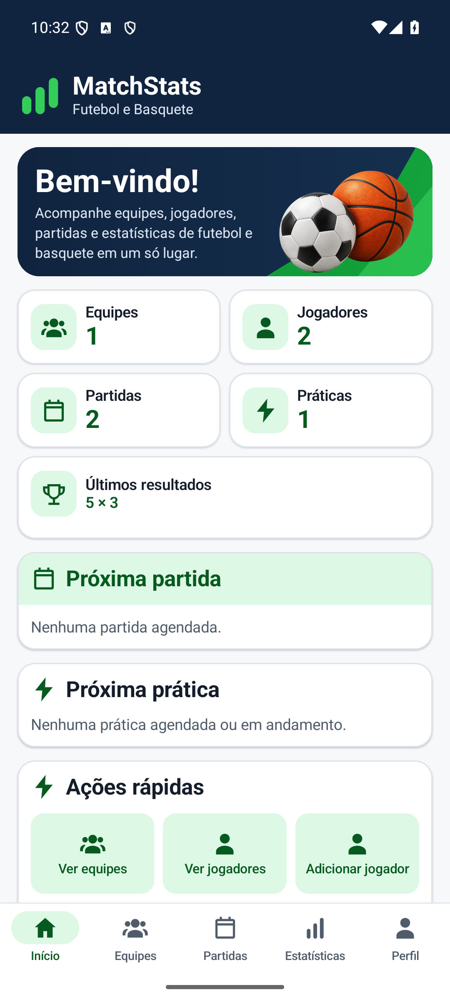
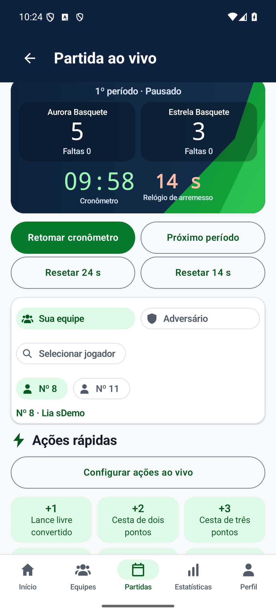
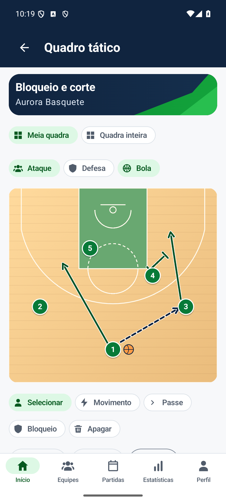

# MatchStats

Aplicativo Android para gerenciamento de equipes, jogadores, partidas, treinos e estatísticas de futebol e basquete.

## Sobre o projeto

O MatchStats reúne a gestão de elencos e o acompanhamento esportivo em um só lugar. Treinadores e equipes amadoras podem registrar jogos e treinos, consultar o desempenho dos atletas e compartilhar relatórios.

## Funcionalidades

- Cadastro de equipes e diretório de jogadores, com o mesmo atleta em vários elencos.
- Partidas de futebol e basquete com acompanhamento ao vivo, placar, cronômetro e registro de eventos.
- Box scores com colunas configuráveis e estatísticas individuais por partida.
- Treinos e exercícios com registro em lote para vários atletas.
- Estatísticas, rankings e gráficos de evolução para jogos e treinos.
- Quadro tático de basquete com movimentações, passes e jogadas salvas.
- Exportação e compartilhamento de relatórios de partida em PDF.

## Tecnologias

Kotlin, Jetpack Compose, Material 3 e Room, com projeto para Android Studio e Gradle Wrapper.

## Instalação

Clone o repositório e abra a pasta `MatchStats` no Android Studio.

```bash
git clone https://github.com/BenPofc/MatchStats.git
```

Sincronize o projeto com o Gradle e instale o SDK Android API 37 pelo SDK Manager caso o IDE solicite. Selecione a configuração `app` e execute a compilação de depuração em um dispositivo ou emulador com Android 8.0 (API 26) ou superior.

## Download do aplicativo

O APK da [versão 0.10.0](https://github.com/BenPofc/MatchStats/releases/tag/v0.10.0) é uma compilação de depuração para demonstração e testes. Baixe o arquivo `MatchStats-0.10.0-debug.apk` e abra-o no Android para instalar. O sistema pode pedir autorização para instalar a partir do app que abriu o arquivo.

## Capturas de tela

Capturas reais do aplicativo com registros de demonstração.

<p>
  
  
  
</p>

## Funcionamento offline

O Room guarda os registros no dispositivo. O cadastro, o acompanhamento de partidas e treinos, as estatísticas e a geração dos relatórios funcionam sem conexão obrigatória. O envio do PDF depende do meio de compartilhamento escolhido.

## Documentação

- [Apresentação Micro-SaaS](presentation/MatchStats_Apresentacao_MicroSaaS_v3.pdf)
- [Especificação do projeto](PROJECT_SPEC.md)
- [Referências de design](design/mockups)
